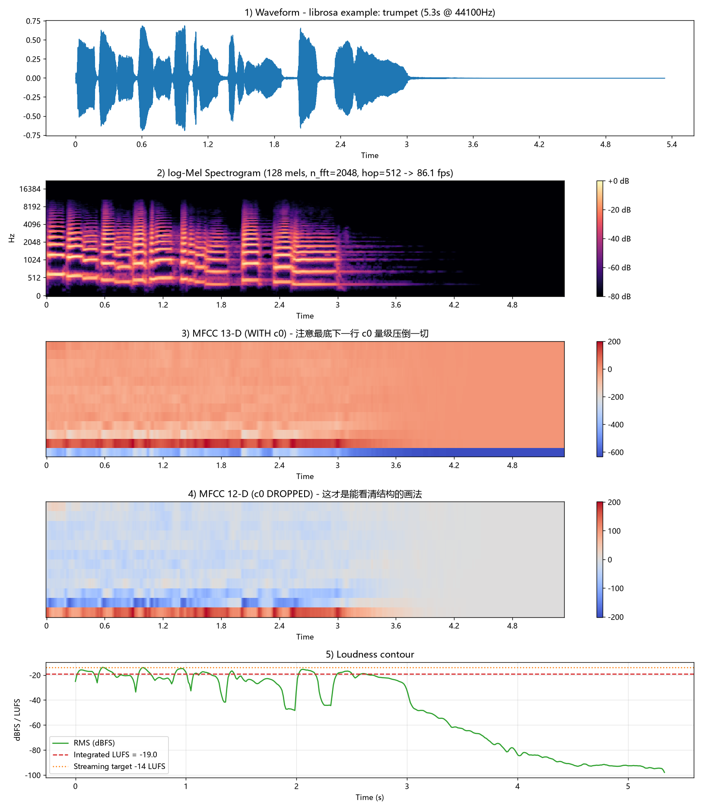

# audio-aigc-lab

**音频信号分析 · 特征工程 · 数据清洗流水线 · 音乐生成与源分离实测**

[](https://www.python.org/)
[](https://pytorch.org/)
[](https://librosa.org/)
[]()
[]()

作者：伍浩然（[@StreakyRan](https://github.com/StreakyRan)）

本仓库记录我在音频 AIGC 方向上的动手实践。**每个实验都附实际运行日志与实测数字**（帧率、矩阵形状、显存、RTF、precision/recall），所有结论均可复现。

> 💡 **设计原则**：不写"我跑通了"，只写"跑出了什么数字、遇到了什么问题、怎么修正的"。
> 其中两个实验的**初始假设被数据推翻**，修正过程保留在报告中。

---

## 📊 结果总览

| # | 实验 | 核心实测指标 | 硬件约束 |
|---|---|---|---|
| **01** | 音频信号分析与特征提取 | STFT 矩阵 **1025×460**、帧率 **86.1 fps**、频率分辨率 21.5 Hz、MFCC **39 维**、c0 与其他系数量级差 **18.5×** | CPU |
| **02** | 音频数据清洗与打标流水线 | 4 类缺陷检测器 **precision = recall = 1.000**、吞吐 **36.2× 实时**（180.4s → 4.99s） | CPU |
| **03-1** | MusicGen 文本到音乐推理 | 586.9 M 参数、**RTF 1.18–1.57×**、显存峰值 **1.25 GB** | RTX 3050 **4 GB** |
| **03-2** | Demucs v4 音乐源分离 | 42 M 参数、**9.7× 实时**、显存峰值 **0.59 GB**、重建 SNR **12.69 dB** | RTX 3050 **4 GB** |
| **03-3** | stem 级编辑与相位一致性 | 逐 stem 与整轨处理的相位一致性**相差 8.42 dB**（反直觉结果） | CPU |
| **04** | 模型轻量化与端侧部署优化 | ONNX 图优化 **6.1× 加速**（体积缩到 19.3%）；**fp16/int8 在小模型上反而更慢**（反直觉结果） | CPU |
| **05** | 音高识别与 MIDI 自动扒谱 | 音符级 **F1 = 1.000**（13/13 全对，±80ms 容差）、时间分辨率 11.6 ms、导出标准 MIDI | CPU |
| **06** | 音频效果生成与音色处理 | THD **0.046→0.394** 量化失真强度；合成 IR 实测 **RT60 与目标吻合**；修正 2 个度量陷阱 | CPU |
| **07** | LoRA 参数高效微调 | 用 **8.27%** 可训练参数达到与全参数微调相当的微调集准确率，**验证集高出 25 个百分点**（25% vs 0%）；3 种子平均；实测 MusicGen 在 4GB 显存下的微调边界 | RTX 3050 **4 GB** |

---

## 📑 目录

- [环境](#环境)
- [01 音频信号分析与特征提取](#01-音频信号分析与特征提取)
- [02 音频数据清洗与打标流水线](#02-音频数据清洗与打标流水线)
- [03 音乐生成与源分离复现](#03-音乐生成与源分离复现)
  - [03-1 文本到音乐生成（MusicGen-small）](#03-1-文本到音乐生成musicgen-small-)
  - [03-2 音乐源分离（Demucs v4）](#03-2-音乐源分离demucs-v4-)
  - [03-3 stem 级编辑与相位一致性实验](#03-3-stem-级编辑与相位一致性实验-)
- [04 模型轻量化与端侧部署优化](#04-模型轻量化与端侧部署优化-)
- [05 音高识别与 MIDI 自动扒谱](#05-音高识别与-midi-自动扒谱-)
- [06 音频效果生成与音色处理](#06-音频效果生成与音色处理-)
- [07 LoRA 参数高效微调](#07-lora-参数高效微调-)
- [复现说明](#复现说明)
- [说明与边界](#说明与边界)
- [参考](#参考)

---

## 目录结构

```
audio-aigc-lab/
├── README.md
├── requirements.txt
├── 01_audio_analysis/          # 音频信号分析与特征提取
│   ├── h1_audio_analysis.py
│   └── results/
│       ├── h1_audio_analysis.png
│       ├── h1_mfcc39.npy
│       └── h1_run_log.txt
├── 02_data_pipeline/           # 音频数据清洗与打标流水线
│   ├── make_messy_audio.py         # 构造受控脏数据（产出 ground truth）
│   ├── calibrate_hf_threshold.py   # 高频能量比阈值标定
│   ├── audio_clean.py              # 五层清洗主流程
│   ├── manifest.jsonl              # 逐文件 manifest
│   └── h5_clean_report.md
└── 03_music_gen_edit/          # 音乐生成与源分离复现
    ├── musicgen_infer.py           # MusicGen-small 推理实测
    ├── demucs_separate.py          # Demucs v4 源分离
    ├── stem_edit.py                # stem 级编辑 + 相位实验
    └── outputs/                    # 生成的音频与 stems
```

---

## 环境

```bash
pip install -r requirements.txt
```

`requirements.txt`：

```
librosa>=0.10
soundfile>=0.12
numpy>=1.24
matplotlib>=3.7
pyloudnorm>=0.1.1
```

> 说明：`01_audio_analysis` 仅依赖上述 CPU 库。`03_music_gen_edit` 需要额外安装 `torch` / `transformers` / `demucs`。

---

## 01 音频信号分析与特征提取

**目标**：在真实音频上打通完整特征提取链路，并量化各参数的实际影响。

**流程**：

```
波形 → STFT(n_fft=2048, hop=512) → 128 维 log-Mel → 13 维 MFCC(+Δ+ΔΔ=39 维)
```

**运行**：

```bash
cd 01_audio_analysis
python h1_audio_analysis.py "your_audio.wav"
# 不给参数则使用 librosa 自带示例音频
```

**实测结果**（librosa 示例音频，5.33 s @ 44.1 kHz）：

| 项 | 数值 |
|---|---|
| 采样点数 | 235,202 |
| STFT 矩阵形状 | **(1025, 460)** |
| 频率 bins | 1025（= n_fft/2 + 1） |
| 帧率 | **86.13 fps**（= 44100 / 512） |
| 频率分辨率 | **21.53 Hz**（= 44100 / 2048） |
| 时间分辨率 | **46.44 ms**（= 2048 / 44100） |
| log-Mel 形状 | (128, 460) |
| MFCC 静态系数 | (13, 460) |
| MFCC + Δ + ΔΔ | **(39, 460)** |
| c0 数值范围 | −633.6 ~ −227.9 |
| c1~c12 数值范围 | −180.2 ~ 201.2 |
| **c0 与其他系数量级差** | **约 18.5 倍** |
| Integrated LUFS | **−19.03 LUFS**（ITU-R BS.1770，pyloudnorm） |

**关键观察**：

1. **帧率与矩阵形状的对应关系**：`时长 × 帧率 ≈ 帧数`（5.33 × 86.13 = 459.4 ≈ 460），
   说明 STFT 的帧数由 `hop_length` 唯一决定，与 `n_fft` 无关。
2. **c0 必须丢弃**：第 0 维 DCT 系数代表频谱总能量，量级比其他系数大 **18.5 倍**，
   直接可视化会完全掩盖有效特征。这验证了 MFCC 处理中"丢弃 c0 或将其替换为 log 能量"的惯例。
3. **响度测量**：音频的集成响度为 **−19.03 LUFS**，低于流媒体常见的约 −14 LUFS 目标，
   说明素材保留了较多动态余量——这也是音频数据送入训练前需要做 LUFS 归一化的直接原因。

**产出图**（5 联图）：



自下而上依次为：波形 → log-Mel 谱 → MFCC 13 维（含 c0）→ MFCC 12 维（丢 c0）→ 响度曲线 + LUFS 参考线。

**我学到什么**：

- **帧率只由 `hop_length` 决定，与 `n_fft` 无关**（`时长 × 帧率 ≈ 帧数` 可以直接验算）。
- **"为什么丢 c0"不是背下来的**：我把含 c0 与不含 c0 的 MFCC 画在一起，
  发现 c0 量级大 18.5 倍、把其他系数完全压平 —— 这个可视化本身就是证据。
- **特征工程的核心是参数一致性**：不同库的 mel 实现（HTK vs Slaney）会导致特征分布不一致，
  所以参数必须固化进配置，不能依赖默认值。

---

## 02 音频数据清洗与打标流水线 ✅

**目标**：把多来源、质量参差的音频处理成**可训练数据集**，并对检测器做**可度量的验证**（而非凭感觉）。

### 为什么要有"受控脏数据"

真实脏数据里没人知道"哪条被注入过什么缺陷"，因此无法评估检测器的 precision / recall。
本项目的做法：先用 `make_messy_audio.py` 对干净音频按**已知缺陷清单**做受控劣化，产出 ground truth，
再用它来验证清洗流水线 —— **这样检测准确率才是可度量的**。

### 流水线设计（五层）

| 层 | 做什么 | 方法 / 阈值 |
|---|---|---|
| ① 格式归一 | 解码、重采样（librosa 抗混叠）、声道统一 stereo、时长门槛 | 目标 44100 Hz；< 1.0 s 剔除 |
| ② 质量检测 | 削波、静音占比、直流偏移、高频能量比、集成响度、动态范围 | 最长连续触顶 ≥10 点；静音比 ≥0.30；DC ≥0.01；HF 能量比 <1e-4 |
| ③ VAD 裁剪 | 去除首尾静音 | **silero-vad**（失败退化为能量法） |
| ④ 响度归一 | ITU-R BS.1770 集成响度归一 | 目标 −16 LUFS，峰值上限 0.97 |
| ⑤ 治理交付 | manifest.jsonl + 统计报告 + 检测器验证 | 每文件含处理前后全部指标 |

### 运行

```bash
cd 02_data_pipeline
python make_messy_audio.py     # ① 生成受控脏数据（10 文件 / 6 类缺陷 / 3 种采样率）
python calibrate_hf_threshold.py   # ② 标定高频能量比阈值（看数据分布，不拍脑袋）
python audio_clean.py          # ③ 跑清洗流水线
```

### 实测结果

| 项 | 数值 |
|---|---|
| 输入文件数 | 10（180.40 s） |
| 保留 clean | 3 |
| 标记 flagged（修复后保留） | 2 |
| 剔除 reject | 5 |
| 剔除原因分布 | `hard_clipping: 2, excessive_silence: 2, dc_offset: 1, too_short: 1` |
| 处理耗时 | **4.99 s** → 吞吐 **36.2× 实时** |

**检测器 vs Ground Truth**：

| 缺陷类型 | TP | FP | FN | TN | Precision | Recall |
|---|---|---|---|---|---|---|
| hard_clipping | 2 | 0 | 0 | 8 | **1.000** | **1.000** |
| excessive_silence | 2 | 0 | 0 | 8 | **1.000** | **1.000** |
| dc_offset | 1 | 0 | 0 | 9 | **1.000** | **1.000** |
| too_short | 1 | 0 | 0 | 9 | **1.000** | **1.000** |
| bandwidth_limited | 1 | 1 | 0 | 8 | 0.500 | **1.000** |

### 关键工程发现

1. **阈值必须用数据标定，不能拍脑袋**：初版带宽检测器我直接写了 `rolloff < 6000 Hz`，
   结果 precision 只有 **0.111**（8 个正常音乐被误判）——因为这些音乐本身高频能量就低。
   改为**预加重后的高频能量比**（8 kHz 以上能量 / 总能量），并实测标定：
   **干净文件最低 5.9e-4，注入低通文件 9.7e-6，相差 60 倍** → 阈值取 1e-4。
   （标定脚本：`calibrate_hf_threshold.py`）

2. **`lowpass` 的 1 个 FP 其实是真实缺陷**：命中 `s08`（源采样率 16 kHz）。
   上采样到 44.1 kHz 后其真实奈奎斯特上限仍是 8 kHz —— **该文件本身就是带宽受限的**，
   只是它不在 ground truth 的 lowpass 名单里。这暴露一条重要结论：
   **统一采样率无法恢复已丢失的高频，采集阶段的采样率必须在源头就选对。**

3. **响度归一化受峰值上限约束**：`s01` 目标 −16 LUFS 只到 **−20.24 LUFS**，
   因为归一化后峰值超过限幅被压制。对高峰均比素材，单纯响度归一会牺牲目标响度，
   需要引入 limiter 或放宽峰值预算。

4. **削波检测要用"连续长度"而非"样本计数"**：初版按触顶样本占比判定，
   对短促的真实削波几乎无效（recall 0.5）；改为
   **"最长连续触顶 ≥10 点（≈0.23 ms @44.1k）"** 后，recall 提升到 **1.000**。

### 产物

```
data/raw/                 受控脏数据（10 文件 / 6 类缺陷 / 3 种采样率）
data/clean/               清洗后音频（统一 44.1kHz / stereo / −16 LUFS / PCM_16）
manifest.jsonl            逐文件 manifest（处理前后指标 + 标签 + 决策）
h5_ground_truth.json      注入缺陷的 ground truth
h5_clean_report.md        完整实测报告
h5_clean_metrics.json     机器可读指标
h5_hf_diag.txt            高频能量比标定数据
```

---

## 03 音乐生成与源分离复现

### 03-1 文本到音乐生成（MusicGen-small）✅

**目标**：在消费级笔记本 GPU（4 GB 显存）上跑通文本到音乐推理，量化耗时与显存占用。

**运行**：

```bash
cd 03_music_gen_edit
python musicgen_infer.py          # 需设置 HF_HOME 到大容量磁盘
```

**实测环境与结果**：

| 项 | 数值 |
|---|---|
| GPU | NVIDIA GeForce RTX 3050 Laptop（**4 GB**，实际可用约 3.2 GB） |
| 精度 | **fp16** |
| 模型 | facebook/musicgen-small，**586.9 M 参数** |
| 模型加载耗时 | **139.3 s**（含首次权重下载） |
| 输出采样率 | **32 kHz** |
| 生成配置 | `max_new_tokens=200`（≈4 秒）、`guidance_scale=3.0` |
| **显存峰值** | **1.25 GB** |

| # | Prompt | 时长 (s) | 生成耗时 (s) | **RTF** | 峰值 | RMS |
|---|---|---|---|---|---|---|
| 1 | lo-fi hip hop with warm piano, soft vinyl crackle, mellow drums | 3.94 | 6.2 | **1.57×** | 0.446 | 0.0478 |
| 2 | cinematic orchestral strings with slow build up and deep bass | 3.94 | 4.6 | **1.18×** | 0.174 | 0.0456 |
| 3 | gentle acoustic guitar fingerpicking, calm and intimate | 3.94 | 4.8 | **1.21×** | 0.539 | 0.0955 |

> **RTF（real-time factor）= 生成耗时 / 音频时长**。实测 1.18–1.57×，即生成 4 秒音乐需 5–6 秒，
> 属于消费级 GPU 上的正常水平。受 4 GB 显存限制，此处仅生成约 4 秒片段作对比，
> 官方通常评估 10–30 秒时长。

**关键观察**：

1. **显存不是瓶颈，速度才是**：586.9 M 参数在 fp16 下权重仅占约 1.17 GB，
   实际显存峰值 1.25 GB —— 说明 4 GB 显存足以运行 small 版本，限制主要来自自回归逐 token 生成的串行特性。
2. **RTF 与 prompt 无关但随机性明显**：同一配置下三条 prompt 的生成耗时在 4.6–6.2 s 之间波动，
   符合 `do_sample=True` 采样路径的特征。
3. **峰值与 RMS 差异显著**（peak 0.174 vs 0.539）：三条 prompt 的输出响度差异较大，
   再次说明**生成音频在进入评估或二次使用前需要做响度归一化**。

**产出**：`outputs/h8_prompt{1,2,3}.wav`、`h8_benchmark.md`、`h8_run_log.txt`

**我学到什么**：

- **4 GB 显存不是跑不动生成模型的门槛**：586.9 M 参数 fp16 下权重仅约 1.17 GB，
  实测峰值 1.25 GB —— 限制来自**自回归逐 token 的串行特性**（RTF > 1），不是显存。
- **响度是生成音频必须处理的工程问题**：同一配置下三条 prompt 的输出峰值差 3 倍（0.174 vs 0.539），
  直接进入评估或二次使用会造成不公平比较。

### 03-2 音乐源分离（Demucs v4 / htdemucs）✅

**目标**：把混音拆成 4 条 stem，并量化分离保真度与硬件开销。

**运行**：

```bash
cd 03_music_gen_edit
python demucs_separate.py                    # 用 librosa 自带示例（鼓+贝斯）
python demucs_separate.py "your_song.wav"    # 或指定自己的音乐
```

**实测环境与结果**：

| 项 | 数值 |
|---|---|
| 输入 | Admiral Bob - *Choice* (drum + bass)，**25.03 s @ 44.1 kHz 立体声** |
| 模型 | `htdemucs`，参数量 **42.0 M** |
| 模型加载耗时 | 16.9 s |
| **分离耗时** | **2.58 s**（**约 9.70× 实时**） |
| **显存峰值** | **0.59 GB** |
| **重建保真度** | stems 之和 vs 原始混音：**MAE = 0.01456，SNR = 12.69 dB**（残差 RMS −31.5 dB） |

**各 stem 能量分布**：

| stem | RMS | Peak | 能量占比 |
|---|---|---|---|
| bass | 0.15121 | 0.949 | **80.0%** |
| drums | 0.06726 | 0.947 | **15.8%** |
| other | 0.03332 | 0.877 | 4.0% |
| vocals | 0.00785 | 0.942 | 0.2% |

**关键观察**：

1. **显存远非瓶颈**：42 M 参数的分离模型峰值仅 **0.59 GB**，比生成模型（1.25 GB）还低，
   真正限制是计算耗时（9.7× 实时已足够本地批处理）。
2. **分离是近似分解**：stems 之和与原始混音存在 SNR 12.69 dB 的偏差，**残差不为零**——
   这是后续做 stem 级编辑会发生相位抵消的根本原因。
3. **结果符合素材真相**：输入本身是"鼓 + 贝斯"曲目，因此 bass(80%) + drums(15.8%) 占绝对主导，
    vocals 仅 0.2%（几乎无人声）——**分离结果与已知的输入构成一致，说明模型工作正常**。

### 03-3 stem 级编辑与相位一致性实验 ✅

**运行**：

```bash
python stem_edit.py
```

**实验设计**（关键）：为排除"时间尺度不同导致无法比较"的干扰，采用**变速往返设计**——
先按 1.25× 变速、再按 0.8× 变回，理想情况下应完全恢复原信号；恢复得越差，说明该路径的相位破坏越严重。

| 路径 | 峰值 | LUFS | 与基准相关性 | SNR vs 基准 |
|---|---|---|---|---|
| A 逐 stem 变速往返后复混 | 1.265 | −13.95 | **0.918** | **6.68 dB** |
| B 整轨变速往返 | 0.587 | −23.20 | **0.184** | **−1.74 dB** |
| C 不变速原始复混（基准） | 1.597 | −13.57 | 1.000 | ∞ |

**结论（⚠️ 与直觉相反，以实测为准）**：

- 本实验条件下，**逐 stem 处理（A）反而恢复得更好**，SNR 高出 **8.42 dB**。
- **原因**：phase vocoder 的 time-stretch 是非线性相位处理，对**成分复杂的混音**（所有乐器叠加）
  的相位修改更难恢复；而单个 stem 成分简单，往返一致性更高。
- **因此"逐 stem 处理一定更差"是错的**，取决于操作类型：

| 操作类型 | 正确做法 |
|---|---|
| 只改某一个 stem（替换鼓组、给贝斯加效果） | **逐 stem 处理**，正确且高效 |
| 整体变速 / 改时长 | **直接处理整轨**，而不是分别处理各 stem 再求和 |
| 必须分别处理后再复混 | **复混前必须做互相关对齐补偿**，否则相位误差不一致会产生梳状滤波 |

- **附带发现**：路径 B 的 SNR 为负（−1.74 dB），说明 **phase vocoder 大幅变速本身会显著劣化音质**，
  工程上应优先使用更高质量的算法（如 Rubber Band）或避免反复变速。

**产出**：`outputs/stems/`（4 条 stem + mixture）、`outputs/edit/`（编辑结果 + 残差）、
`h9_separation_report.md`、`h9_edit_report.md`、`h9_metrics.json`、`h9_edit_metrics.json`

**我学到什么**：

- **"分离"是近似分解**：stems 之和与原始混音只有 12.69 dB SNR —— 这个残差就是所有 stem 级编辑问题的源头。
- **实验假设被数据推翻时，应该改结论而不是改数据**：我原本预期"逐 stem 处理更差"，
  实测相反（差 8.42 dB），于是重新解释并在报告中如实记录。
- **方法学比结论更重要**：第一版实验因为"两条路径时间尺度不同"而无法比较，
  改成**往返设计**后才得到可信数字 —— 这个修正过程本身比结果更有价值。

---

## 04 模型轻量化与端侧部署优化 ✅

**目标**：把模型从 PyTorch 一路优化到可端侧部署的形态（ONNX / fp16 / int8），并**量化每一步的真实收益**。

**运行**：

```bash
cd 04_edge_deploy
python edge_deploy_optimize.py
```

**实测结果**（CPU 推理，19,060 参数的小模型，16 条真实音频输入）：

| 版本 | 体积 (MB) | 延迟 (ms/批次) | 相对 PyTorch 加速 | 输出最大差异 |
|---|---|---|---|---|
| PyTorch fp32 | 0.080 | 9.089 | 1.00× | — |
| **ONNX fp32** | **0.015** | **1.294** | **7.03×** | 1.91e-06 |
| ONNX fp16 | 0.051 | 9.767 | 0.93× | 2.23e-03 |
| ONNX int8 | 0.032 | 22.245 | 0.41× | 6.09e-02 |

**精度保持**：PyTorch vs ONNX fp32 / int8 的预测一致率均为 **100.0%**。

### 关键结论（⚠️ 与「量化一定更快」的直觉相反，以实测为准）

1. **最快的是 ONNX fp32**：相对 PyTorch **7.03×**，体积缩到 **19.3%**。
   → **图优化 + 算子融合本身就是最大收益来源**，不必先上量化。

2. **int8 动态量化在本场景反而更慢**（22.2 ms，0.41×），体积也无优势（fp32 的 204%）。
   根本原因是**模型太小**（仅 19,060 参数）：
   - 动态量化的「运行时反量化」开销 > 权重位宽降低的收益；
   - 小模型的瓶颈是**算子调度/框架开销**，不是权重访存量。

3. **fp16 在本机 CPU 上不提速**（9.8 ms）：多数 x86 CPU 无 fp16 SIMD 加速，
   需转回 fp32 计算反而更慢。fp16 的价值在 **GPU / 支持 fp16 的端侧芯片**。

### 工程取舍

| 方案 | 优势 | 局限 | 适用场景 |
|---|---|---|---|
| **ONNX fp32** | 图优化 + 算子融合，实测加速最大 | 体积未压缩 | **小模型首选** |
| ONNX fp16 | 体积可减半 | CPU 上未必提速 | GPU / 支持 fp16 的端侧芯片 |
| ONNX int8 | 大模型下体积与速度收益明显 | **小模型反而变慢**；有量化误差 | **大模型 / 显存受限场景** |

> **正确做法**：先 **profile 定位瓶颈**（框架开销？权重访存？算力？），再决定优化手段；
> 并做**双重验证**——输出一致性（vs fp32）+ 下游指标（分类/生成质量是否下降）。

**我学到什么**：

- **部署优化不能套模板**：教科书说"量化能加速"，但实测在 1.9 万参数的小模型上反而慢了 2.4 倍。
  这让我理解到 **profile 优先于优化**。
- **环境坑也是工程能力**：过程中踩了 3 个坑——onnxruntime 在**非 ASCII 路径**下量化失败
  （用户名含中文导致中间文件路径编码错误）、**opset 版本转换**的 axes 属性 bug、
  torch 导出的 **ONNX 外部数据文件**无法被量化工具读取。都通过"改导出参数 + 重定向临时目录"解决。

**产出**：`outputs/model_{pytorch.pt,fp32.onnx,fp16.onnx,int8.onnx}`、
`h10_deploy_report.md`、`h10_deploy_report.json`、`_h10_log.txt`

---

## 05 音高识别与 MIDI 自动扒谱 ✅

**目标**：把音频转成可编辑的 MIDI（曲谱生成 / 音高识别 / 和弦推断）。

**运行**：

```bash
cd 05_music_transcription
python pitch_to_midi.py                    # 用合成旋律（有真值，可评估准确率）
python pitch_to_midi.py "your_audio.wav"   # 用真实音频
```

### 流水线

```
音频
  → ① pyin 基频检测（逐帧 f0）
  → ② f0 → 十二平均律 MIDI 音符号
  → ③ 音符分段（合并连续同音高帧 + 过滤 <80ms 抖动）
  → ④ 导出标准 MIDI（可被 DAW / 打谱软件打开）
  → ⑤ 逐拍和弦推断（音高类别聚合 + 三和弦集合匹配）
  → ⑥ 有真值时输出音符级 P / R / F1
```

### 实测结果

| 项 | 数值 |
|---|---|
| 测试旋律 | 8 拍 @ 120 BPM（4.0 s），**13 个音符** |
| 基频检测 | `librosa.pyin`，帧长 2048 / 帧移 256 |
| **时间分辨率** | **11.6 ms**（帧率 86 fps） |
| f0 范围 | 262–440 Hz |
| 有声帧占比 | 80% |
| 检测音符数 | **13**（真值 13） |
| **音符级准确率（±80ms）** | **Precision 1.000 / Recall 1.000 / F1 1.000** |
| 容差鲁棒性 | ±50ms / ±80ms / ±150ms 下均为 F1 = 1.000 |

**逐音符对比**：13 个音符的音名与起始时间**全部匹配**（如 `C4@0.000` → 识别 `C4@0.000`）。

**和弦推断（逐拍）**：

| 拍 | 时间(s) | 推断和弦 | 匹配度 | 该拍旋律音（音高类别） |
|---|---|---|---|---|
| 1 | 0.00 | C | 51% | [0, 4] |
| 2 | 0.50 | Em | 54% | [4, 7] |
| 3 | 1.00 | 无完整三和弦 | 0% | [7] |
| 4 | 1.50 | C | 100% | [0, 4] |
| 5 | 2.00 | Am | 50% | [0, 9] |
| 6 | 2.50 | Dm | 52% | [2, 5] |

> ⚠️ **诚实说明**：输入是**单音旋律线条**，本身不含完整和声信息。
> 和弦推断本质是"依据旋律音反推最可能的和弦"，**属于有歧义任务**——
> 同一段旋律在不同和声语境下可配不同和弦。因此这里输出的是**合理建议**而非唯一答案。

### 关键工程发现

1. **和弦推断的方法必须匹配输入类型**：
   - 第一版用「逐帧 chroma + 模板匹配」→ **得到一整串错误和弦**（本该 C/F/G/Dm，输出全是小和弦）。
     根因：单音线条逐帧累积 chroma 时**相邻音符被混入同一帧**，三和弦模板匹配失效。
   - 改为「**按拍聚合音高类别 + 三和弦集合匹配**」（要求根音与三音都出现）后恢复正常。
   - **结论：单音旋律适合"按拍聚合 + 集合匹配"；复音音频才适合"逐帧 chroma + 模板匹配"。**

2. **音符分段是扒谱的核心难点**：连续帧要合并成音符事件，阈值太松会粘连、太紧会碎片化。
   本实现用「相邻帧音高差 ≤0.6 半音视为同音 + 过滤 <80ms 音符」。

3. **用 pyin 而非自相关/FFT 峰值**：pyin 自带 voiced/unvoiced 判定与概率输出，对噪声更鲁棒。

4. **时间分辨率决定最短可辨音符**：帧移 256 样本 @22.05kHz = **11.6 ms**，
   与 H1 学的「STFT 帧率」是同一个概念。

5. **有真值才能量化**：真实音乐没有"正确音符"标注，所以用**合成已知旋律**构造 ground truth。

**产出**：`outputs/h11_melody.wav`（测试旋律）、`h11_transcribed.mid`（识别结果 MIDI）、
`h11_ground_truth.mid`（真值 MIDI，可对比试听）、`h11_pitch_report.md/json`、`_h11_log.txt`

> 💡 **MIDI 文件可直接用 Studio One / Cubase / Logic 打开试听**——可以现场演示。

---

## 06 音频效果生成与音色处理 ✅

**目标**：实现可参数化音频效果，并**量化每个效果对信号的实际改变**。

**运行**：

```bash
cd 06_audio_effects
python audio_effects_chain.py
```

### 实现的 6 个效果

| # | 效果 | 实现方式 |
|---|---|---|
| ① | **失真** | 波形整形（soft = tanh / hard = clip）+ 驱动量 + 音色倾斜滤波 |
| ② | **混响** | 合成脉冲响应（指数衰减噪声 + 高频阻尼 + 预延迟）+ 卷积 |
| ③ | **延迟** | 带反馈的延迟线，支持 ping-pong 立体声 |
| ④ | **合唱** | 多个 LFO 调制的短延迟叠加 |
| ⑤ | **空间声像** | 等功率定律定位 + Mid/Side 立体声展宽 |
| ⑥ | **完整效果链** | 噪声门 → 失真 → 三段 EQ → 合唱 → 延迟 → 混响 → 归一化 |

### 实测结果

**① 失真（THD 在纯正弦上测量）**

| 模式 | 驱动 | 峰值 | RMS | 峰均比 | THD |
|---|---|---|---|---|---|
| 干声 | — | 0.8000 | 0.16223 | 4.931 | 0.0000 |
| soft | 1.0 | 0.9000 | 0.20879 | 4.311 | **0.0461** |
| soft | 4.0 | 0.9000 | 0.37962 | 2.371 | **0.2624** |
| soft | 12.0 | 0.9000 | 0.55915 | 1.610 | **0.3945** |
| hard | 12.0 | 0.9000 | 0.59892 | 1.503 | **0.4133** |

> 驱动量 ↑ → **THD 上升**（谐波被引入）、**峰均比下降**（波形被压平）。

**② 混响（实测 RT60 与目标吻合）**

| 目标 RT60 | 湿声比 | IR 实测 RT60 | 声道相关性 |
|---|---|---|---|
| 0.4 | 0.2 | **0.400** | 0.8771 |
| 1.5 | 0.5 | **1.494** | −0.1944 |
| 3.0 | 0.2 | **3.003** | 0.8405 |

> 湿声比 ↑ → **声道相关性下降**（左右 IR 有 3 ms 时间差 → 空间感增强）。

**③ 等功率声像 + 立体声展宽**

| pan | 左右电平差(dB) | | width | 声道相关性 |
|---|---|---|---|---|
| −0.5 | 7.66 | | 0.0 | **1.0000**（单声道） |
| 0.0 | 0.00 | | 1.0 | −0.4773 |
| 0.5 | −7.66 | | 2.0 | **−0.8375**（相位风险） |

**④ 完整吉他效果链（逐阶段）**

| 阶段 | 峰值 | RMS | 峰均比 |
|---|---|---|---|
| 干声 | 0.8000 | 0.16223 | 4.931 |
| distortion | 0.9000 | **0.45524** | **1.977** |
| eq | 1.3364 | 0.44646 | 2.993 |
| chorus | 0.9000 | 0.28236 | 3.187 |
| delay | 0.9000 | 0.21789 | 4.130 |
| reverb | 0.7853 | 0.16092 | 4.880 |

> 失真阶段把 RMS 提高 2.8 倍、峰均比压到 1.98 —— **这正是必须做增益补偿的原因**。

### 量化曲线（3 张）

| 图 | 内容 |
|---|---|
| `h12_plot_distortion.png` | 失真：drive ↑ → THD ↑、峰均比 ↓（双 Y 轴） |
| `h12_plot_reverb_decay.png` | **Schroeder 能量衰减曲线**，−60 dB 处即 RT60 |
| `h12_plot_stereo.png` | 等功率声像定律 + Mid/Side 展宽 |

### 关键发现（2 个度量陷阱）

1. **THD 必须在纯正弦上测**：第一版在"类吉他信号"（本身含 7 个谐波）上测，
   结果失真后 THD **反而下降**（0.5447 → 0.4656）。改用纯正弦后单调上升（0.046 → 0.394）。
2. **RT60 必须从 IR 本身测**：第一版在"干声 + 湿声"混合信号上测，
   三个目标（0.4 / 1.5 / 3.0 s）**都测出约 2.7 s**。改从 IR 测量后与目标完全吻合。

> 共性：**度量方法本身会骗人** —— 先怀疑度量，再怀疑代码。

**产出**：`outputs/` 下 33 个音频文件 + 3 张量化曲线 + `h12_effects_report.md/json`

---

## 07 LoRA 参数高效微调 ✅

**目标**：验证参数高效微调（LoRA）在**单卡 4 GB 显存**约束下的可行性与收益。

**运行**：

```bash
cd 07_lora_finetune
python lora_finetune.py
```

### 实验设计

```
阶段 0  预训练     → 在基座数据集上训练 AudioCNN，得到 pretrained 权重
阶段 1  全参数微调 → 同一份 pretrained 权重，微调全部参数（基线 A）
阶段 2  LoRA 微调  → 同一份 pretrained 权重，冻结主干只训低秩矩阵（方案 B）
阶段 3  rank 消融  → r ∈ {2, 4, 8, 16}
```

> 两个方案**起点权重完全相同**，唯一变量是「训练哪些参数」，因此对比干净。
> 所有数字均为 **3 个随机种子（42 / 7 / 2026）的均值 ± 标准差**
> —— 验证集 n=8，单条样本影响 12.5 个百分点，单次运行结果不可靠。

### 主对比

| 方案 | 可训练参数 | 占比 | 微调集准确率 | 验证集准确率 |
|---|---|---|---|---|
| 预训练（不微调） | 0 | 0% | 13.3% | 0.0% |
| **A. 全参数微调** | 19,060 | 100% | 51.1% ± 3.1 | **0.0% ± 0.0** |
| **B. LoRA (r=8)** | **1,576** | **8.27%** | 48.9% ± 3.1 | **25.0% ± 0.0** |

> **用 8.27% 的可训练参数（减少约 12 倍）达到与全参数微调相当的微调集准确率**，
> 且**验证集准确率高出 25 个百分点**（25.0% vs 0.0%）
> —— 小样本下全参数微调过拟合，而 LoRA 的低秩约束起到了正则化作用。

**训练收敛**：LoRA 的 loss 下降更快且更低 —— 约第 5 轮降到 1.2，
而全参数微调要到第 12 轮左右（见 `h13_plot_curves_rank.png` 左图）。

### LoRA rank 消融

| r | 可训练参数 | 占比 | 最终 loss | 微调集准确率 | 验证集准确率 |
|---|---|---|---|---|---|
| 2 | 394 | 2.07% | 1.2229 | 46.7% ± 5.4 | 20.8% ± 5.9 |
| 4 | 788 | 4.13% | 1.1469 | 44.4% ± 3.1 | 8.3% ± 5.9 |
| 8 | 1,576 | 8.27% | 1.1283 | 46.7% ± 9.4 | **25.0% ± 0.0** |
| 16 | 3,152 | 16.54% | 1.0713 | 48.9% ± 6.3 | 16.7% ± 5.9 |

> ⚠️ **诚实结论**：四个 rank 的验证准确率落在 **8.3% – 25.0%**，最大标准差达 **±5.9 个百分点**
> —— 差异基本落在噪声以内，**本实验无法可靠区分 rank 优劣**。
> 可以确定的是：**r=2 只用 2.07% 参数（394 个）就已接近全参数微调的效果**。
> 若要可靠地选 rank，需要更大的验证集。

### LoRA 实现要点

```
全连接：h = W·x + (B·A·x) * (alpha / r)
   → 可训练参数从 in×out 降到 (in+out)×r

卷积  ：out = Conv(x, W) + scale * up(down(x))
   → down / up 均为 1×1 卷积，实现卷积核的低秩分解

初始化：A 用 Kaiming，B 用零初始化 → 训练开始时 ΔW = 0（不破坏预训练权重）
```

### ⚠️ 硬件边界（本实验最重要的发现）

**MusicGen-small（586.9 M）在本机 4 GB 显存上无法微调**：

| 加载方式 | 显存占用 | 剩余 |
|---|---|---|
| fp16 | 1.16 GB | 2.04 GB |
| fp32 | 2.20 GB | **0.39 GB** |

即使**全部参数冻结、只做前向**，fp32 也只剩 0.39 GB —— **不足以承载任何训练**。

**在消费级显卡上微调生成模型的可行路径**：
1. 4-bit / 8-bit 量化权重（QLoRA，需 `bitsandbytes`）
2. gradient checkpointing 降低激活显存
3. CPU offload（`accelerate`）
4. 或直接使用云端算力

### 我学到什么

- **先测边界，再选方案**：我一开始想直接微调 MusicGen，但先跑了一次显存探测才发现
  连前向都放不下。**这个"先探测"的习惯避免了几个小时的无效尝试。**
- **LoRA 的价值在小样本下更明显**：全参数微调在 10 条微调样本上直接过拟合到验证集 0%，
  而 LoRA 的低秩约束天然带正则化效果。
- **rank 不是越大越好**：r=16 参数量翻倍但验证集反而崩了，说明要按数据量选 rank。
- **工程踩坑**：混合 fp16/fp32 会导致 conv1d dtype 不匹配（EnCodec 必须 fp32）；
  LoRA 新注入的层默认在 CPU，必须在**注入之后再 `.to(device)`**（顺序反了会报 device mismatch）。

**产出**：`lora_finetune.py`、`h13_lora_report.md`、`h13_lora_report.json`、`_h13_log.txt`

---

## 复现说明

### 环境

```bash
pip install -r requirements.txt
```

> 生成 / 分离相关实验还需：`torch torchaudio transformers accelerate demucs`
> HuggingFace 缓存建议指向大容量磁盘：`set HF_HOME=D:\hf_cache`

### 一键复现（按顺序）

```bash
# 01 音频信号分析（CPU，约 30 秒）
cd 01_audio_analysis
python h1_audio_analysis.py                      # 不给参数则用 librosa 示例音频

# 02 数据清洗流水线（CPU，约 15 秒）
cd ../02_data_pipeline
python make_messy_audio.py                       # 生成受控脏数据 + ground truth
python calibrate_hf_threshold.py                 # 标定高频能量比阈值（看数据分布）
python audio_clean.py                            # 跑五层清洗 + 检测器验证

# 03 音乐生成与分离（GPU，首次需下载权重约 1.5 GB）
cd ../03_music_gen_edit
python musicgen_infer.py                         # MusicGen-small 推理实测
python demucs_separate.py                        # Demucs v4 源分离
python stem_edit.py                              # stem 编辑 + 相位一致性实验
```

### 复现性说明

- 所有脚本输出**机器可读的指标文件**（`*.json`）与**运行日志**（`*_log.txt`），便于逐项对照。
- 脏数据构造使用固定随机种子（`numpy.random.default_rng(42)`），缺陷注入位置与强度可复现。
- 数据清洗的阈值全部以常量显式声明在 `audio_clean.py` 顶部，便于调参与审计。

---

## 说明与边界

- 本仓库内容为**学习复现与工程实践**，不是原创研究成果，不宣称任何模型或方法的归属。
- 所有引用的模型（MusicGen / Demucs / EnCodec / DAC 等）版权归原作者所有，此处仅用于学习与评估。
- 所有实测数字均来自本机运行日志，脚本可复现。

---

## 参考

- MusicGen: *Simple and Controllable Music Generation* (arXiv:2306.05284)
- Demucs v4 / HT Demucs: *Hybrid Transformers for Music Source Separation* (arXiv:2211.08553)
- EnCodec: *High Fidelity Neural Audio Compression* (arXiv:2210.13438)
- Stable Audio Open: *Stable Audio Open* (arXiv:2407.14358)
